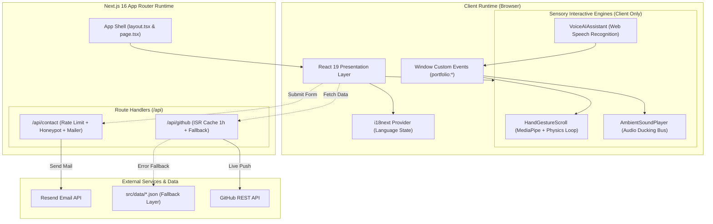

# SYSTEM ARCHITECTURE SPECIFICATION
**Project:** Ly Van My (LVSTANTS) Portfolio  
**Core Stack:** Next.js 16 (App Router), React 19, TypeScript, Tailwind CSS v4, Turbopack  
**Last Updated:** November 6, 2026  

---

## 1. System Overview

This system is architected around a **High-Performance Jamstack & Sensory-Driven Client Engine**:
- **Hybrid SSR & SSG Pipeline:** Core pages are pre-rendered at build time with full SEO metadata and JSON-LD structured schemas, enabling sub-second Largest Contentful Paint (LCP).
- **Isolated Client-Side Sensory Layer:** Resource-intensive multimodal modules (MediaPipe computer-vision hand tracking, Web Speech API voice synthesis, Web Audio ducking) run strictly in the browser runtime, completely decoupled from server-side hydration.
- **Fail-Safe Data Layer:** Critical routes employ defensive programming with dual-source fallback strategies, ensuring the application remains functional even when third-party upstream APIs fail.

---

## 2. High-Level Architecture Diagram



---

## 3. Layered Architectural Decomposition

### 3.1 App Shell & Routing Layer (`src/app`)
- **`layout.tsx` (Root Layout):**
  - Manages font definitions (`Inter`, `Cormorant Garamond`), viewport configurations, canonical alternates, and global Schema.org microdata (`Person`, `WebSite`).
  - Wraps the entire subtree in `I18nProvider` featuring a strict client-mount barrier to eliminate React 19 hydration mismatches.
  - Mounts `InteractiveWidgets` at root level to maintain continuous background audio playback and gesture state across route transitions.
- **Route Topology:**
  - `/about-us`: Full engineering dossier, architectural philosophies, and enterprise milestones.
  - `/projects`: Comprehensive repository showcase with Graph View and Table View visualizers.
  - `/contact`: Dedicated contact portal with live validation, copy helpers, and email integration.
  - `/privacy-policy` & `/terms-of-service`: Reusable legal document engine (`LegalDocument.tsx`) driven by a sticky Table of Contents that tracks viewport scrolling via `useScrollSpy`.

### 3.2 Sensory Interactive Engines (`src/components/InteractiveWidgets.tsx`)
All sensory modules are dynamically imported using `next/dynamic` with `{ ssr: false }`:

1. **`HandGestureScroll.tsx` (Computer-Vision Touchless Scrolling):**
   - **Framework:** MediaPipe Hands loaded dynamically via CDN, performing local video frame classification.
   - **3-Frame Hysteresis Filter:** Eliminates gesture flicker by evaluating a rolling window of 3 consecutive frames before accepting a state transition.
   - **Virtual Float Physics Engine:** Implements continuous momentum physics (`currentVelocityRef`, `targetVelocityRef`) refreshed inside a `requestAnimationFrame` loop. Scrolling remains smooth at 18px/frame and triggers instantaneous deceleration when a fist gesture (`FIST_BRAKE`) is detected.

2. **`VoiceAIAssistant.tsx` (Speech Command Recognition):**
   - **API:** Native Web Speech API (`SpeechRecognition` / `webkitSpeechRecognition`).
   - **Decoupled Event Bus:** Dispatches custom events on the global `window` object (`portfolio:toggle-music`, `portfolio:duck-music`, `portfolio:scroll-*`), enabling communication across components without prop drilling or heavy state containers.

3. **`AmbientSoundPlayer.tsx` (Background Music & Audio Ducking):**
   - **Engine:** YouTube IFrame API utilizing the privacy-enhanced `youtube-nocookie.com` host.
   - **Audio Ducking Implementation:** Listens to `portfolio:duck-music`. When the user activates the microphone or speaks, background volume automatically drops to 15%, restoring to 50% once voice input ceases.

### 3.3 Internationalization Layer (`src/config/i18`)
- **Libraries:** `react-i18next` coupled with `i18next-browser-languagedetector`.
- **Resolution Strategy:** Local storage takes precedence, seamlessly falling back to browser navigator settings.
- **Modular Namespace Structure:**
  - `src/i18n/locales/vi/`: `nav.json`, `home.json`, `about.json`, `skills.json`, `projects.json`, `certificates.json`, `experience.json`, `footer.json`, `contact.json`, `legal.json`.
  - `src/i18n/locales/en/`: Symmetrical English translations mirroring key definitions 1:1.
- **Hydration Guard Pattern:**
  ```tsx
  // Hydration guard pattern preventing server-client render discrepancies
  const [mounted, setMounted] = useState(false);
  useEffect(() => { setMounted(true); }, []);
  if (!mounted) return <FallbackSkeleton />;
  return <div>{t("namespace.key")}</div>;
  ```

---

## 4. API Routes, Security & Reliability Layer

### 4.1 GitHub Repositories Endpoint (`/api/github`)
- **Purpose:** Fetches and normalizes live public repositories for GitHub user `lvstants03`.
- **Caching Strategy:** Incremental Static Regeneration configured at `next: { revalidate: 3600 }` (1 hour).
- **Graceful Degradation:** If the upstream GitHub API returns a non-200 status or rate-limit error, the handler automatically falls back to local data from `src/data/projects.json` with `source: "fallback"`.

### 4.2 Contact Form Submission Endpoint (`/api/contact`)
- **Shared Validation Engine:**
  - Logic centralized in `src/lib/contactValidation.ts` for consistent client-side and server-side verification.
  - Enforces Name constraints (2 - 60 chars), RFC-compliant Email format, pre-defined Subject values, and Message length (10 - 2000 chars).
- **Multi-Tier Anti-Spam Architecture:**
  - **Honeypot Trap:** Hidden `website` input field; submissions containing a value in this field return a mock success response immediately without sending an email.
  - **In-Memory Rate Limiter:** Enforces a threshold of 3 requests per 60 seconds per client IP address.
  - **Email Service Integration:** Communicates directly with the Resend REST API via `RESEND_API_KEY`. If unconfigured, the server returns a `503 MAIL_NOT_CONFIGURED` status code, prompting the client UI to provide a direct `mailto:` fallback.

---

## 5. Performance Engineering & SEO Architecture

1. **Sub-Second Largest Contentful Paint (LCP):**
   - The primary avatar image utilizes `priority`, `loading="eager"`, and a blur placeholder to guarantee immediate visual delivery.
   - Heavy dependencies (MediaPipe, YouTube SDK) are deferred until after the primary page content finishes rendering.
2. **Comprehensive Technical SEO:**
   - **Dynamic Metadata:** Comprehensive OpenGraph, Twitter Card, and canonical URLs declared per route in `layout.tsx` and `page.tsx`.
   - **Automated Sitemaps & Robots:** `src/app/sitemap.ts` and `src/app/robots.ts` calculate route priorities and indexability dynamically.
   - **Structured Data:** High-fidelity JSON-LD schema injected into the root document head, declaring `Person` and `WebSite` entities to optimize search engine rich snippets.
